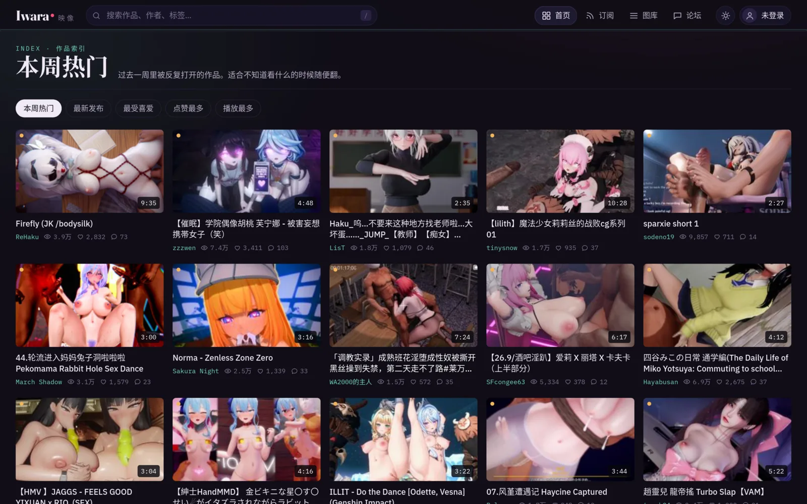
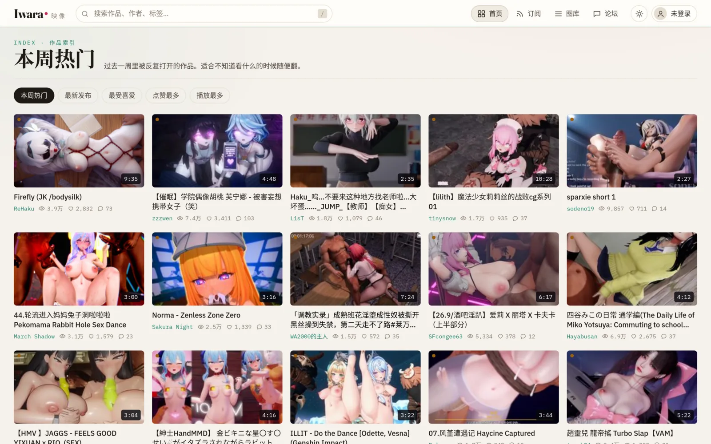
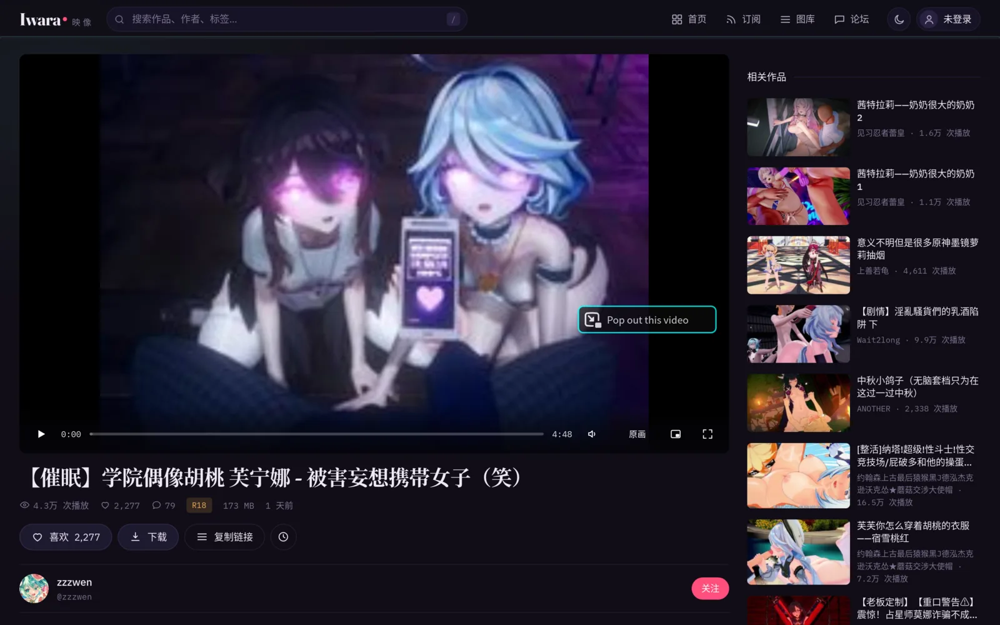
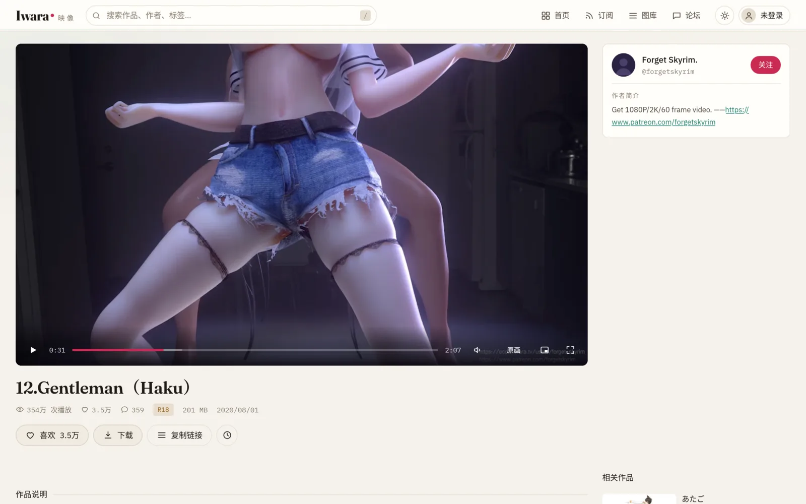
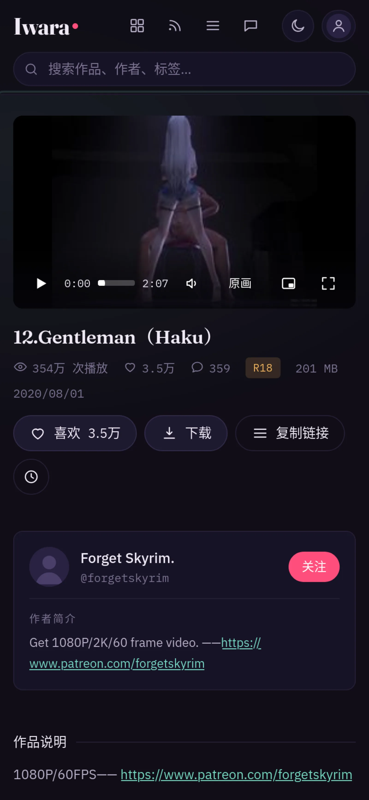
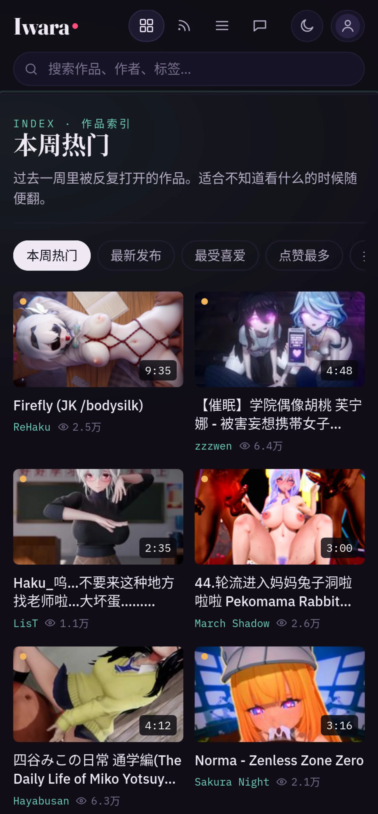
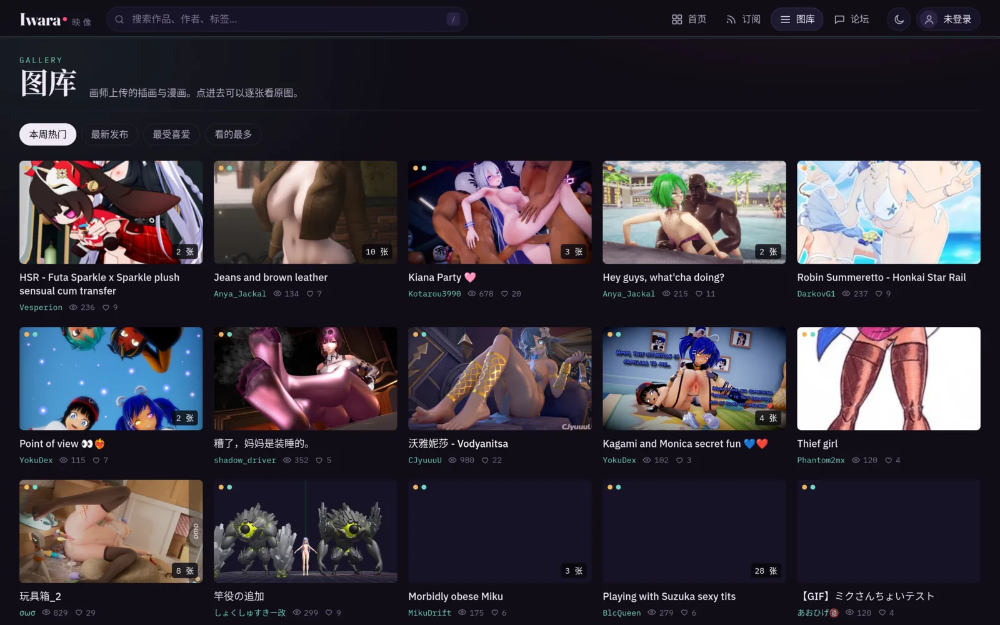
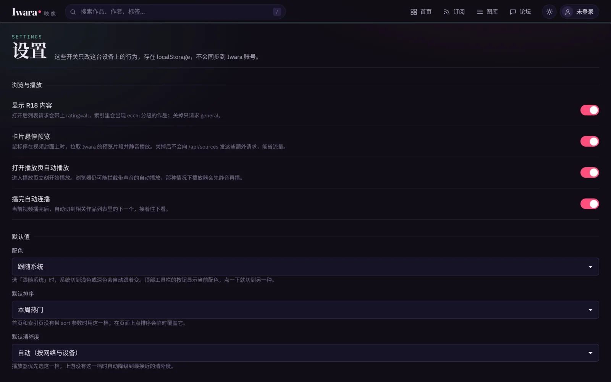
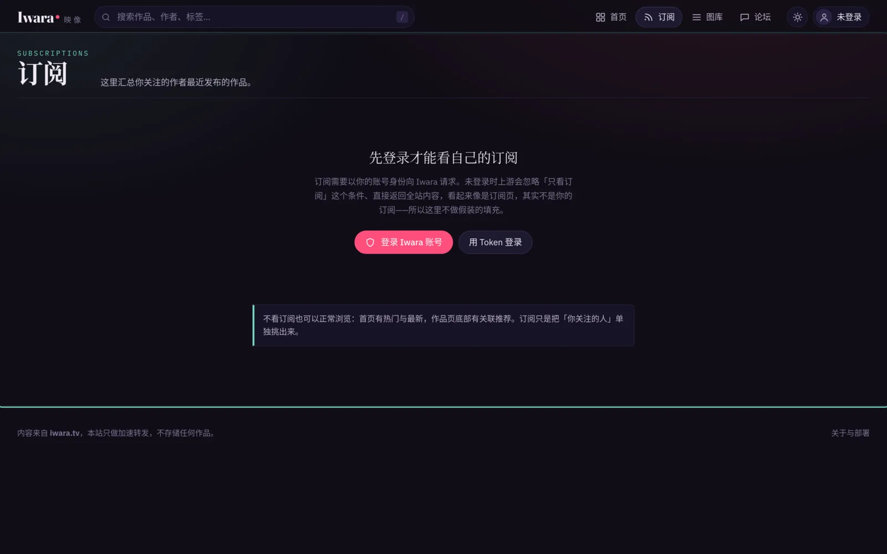

<h1 align="center">Iwara 映像</h1>

<p align="center">
  <strong>把 Iwara 搬到 Cloudflare 边缘网络上的完整网页版</strong><br />
  一个 Worker 同时承担网页、接口反代与视频流代理，打开浏览器就能用。
</p>

<p align="center">
  
  
  
  
</p>

---

## 这是什么

[iwara.tv](https://www.iwara.tv) 是一个视频与插画的创作分享站，但它对部分网络环境不友好。
这个项目把整个站搬到了 Cloudflare 的全球网络上：页面、接口和视频流全部经由你自己的 Worker 转发，
不需要额外服务器，也不需要第三方中转。

界面是一套完整的单页应用——作品索引、标签、图库、播放列表、作者页、论坛、评论区，
配上自建的播放器：清晰度切换、进度条悬停预览、双击全屏、长按 2 倍速、
以及**切页面不中断的迷你播放器**。

## 界面

<table>
<tr>
<td width="50%"><br /><sub><b>作品索引</b> · 五种排序，每页 30 件</sub></td>
<td width="50%"><br /><sub><b>浅色主题</b> · 暖白纸底，可跟随系统</sub></td>
</tr>
<tr>
<td width="50%"><br /><sub><b>播放页</b> · 左栏播放与评论，右栏作者与相关作品</sub></td>
<td width="50%"><br /><sub><b>播放页（浅色）</b> · 画面区始终保持深色</sub></td>
</tr>
<tr>
<td width="50%"><br /><sub><b>手机播放页</b> · 视频 → 标题 → 作者 → 说明 → 评论 → 相关</sub></td>
<td width="50%"><br /><sub><b>手机首页</b> · 双列瀑布流，进度条加粗</sub></td>
</tr>
<tr>
<td width="50%"><br /><sub><b>图库</b> · 插画与动图，可逐张查看原图</sub></td>
<td width="50%"><br /><sub><b>设置</b> · 分级、悬停预览、清晰度、配色、Token</sub></td>
</tr>
<tr>
<td width="50%"><br /><sub><b>订阅</b> · 只看关注的作者，未登录会说明原因</sub></td>
<td width="50%"></td>
</tr>
</table>

## 能做什么

| 模块 | 说明 |
| :-- | :-- |
| 作品索引 | 本周热门 / 最新 / 最受喜爱 / 点赞最多 / 播放最多，无限滚动 |
| 播放器 | 清晰度切换、进度条悬停预览、双击全屏、长按 2 倍速、画中画、键盘快捷键 |
| 悬停预览 | 鼠标停在封面上播放 Iwara 自带的预览片段，左右移动可擦拭进度 |
| 迷你播放器 | 切页面视频不中断，搬进右下角继续播，回来时进度不丢 |
| 标签 | 点作品下方的标签，进入该标签的作品列表 |
| 图库 | 插画作品列表与多图浏览（键盘 ← → 切换） |
| 播放列表 · 作者页 | 列表与详情；作者的作品 / 图库 / 粉丝 / 关注，可关注取关 |
| 论坛 · 帖子 | 只读浏览 |
| 评论区 | 阅读与发表（登录后）；条目多时自动分页，每页 20 条 |
| 搜索 | 视频 / 图库 / 作者 / 论坛 / 帖子，**需登录**（上游接口要求认证） |
| 订阅 | 只看关注的作者，**需登录**（未登录时上游会静默忽略该条件） |
| 收藏 · 观看历史 | 收藏需登录；历史存在本机，含续播进度，可逐条删除 |
| 账号登录 | 邮箱密码登录，Token 加密存放在 HttpOnly Cookie 里 |
| 站点访问密码 | 整站加锁，与 Iwara 账号无关，密码由 Worker 变量配置 |
| 主题 | 深色 / 浅色 / 跟随系统，工具栏一键切换 |

## 快速部署

前置：Node.js 18+ 与一个 Cloudflare 账号（免费版足够）。

```bash
git clone https://github.com/<你的用户名>/iwara-web-proxy.git
cd iwara-web-proxy

npx wrangler login
npx wrangler secret put SESSION_SECRET     # 至少 16 位随机串，openssl rand -base64 32
npx wrangler secret put SITE_PASSWORD      # 站点访问密码（可选但强烈建议）
npx wrangler deploy
```

部署完会输出形如 `https://iwara-web.<你的子域>.workers.dev` 的地址。

**开箱即可用**：不配任何 secret 也能浏览和播放全站公开内容，只是搜索、订阅、收藏这些
需要 Iwara 账号的功能会不可用。

## 配置

### 普通变量（`wrangler.jsonc` 的 `vars`）

| 变量 | 默认值 | 作用 |
| :-- | :-- | :-- |
| `SITE_NAME` | `Iwara 映像` | 站点名称，显示在标题与登录页 |
| `DEFAULT_SITE` | `main` | 内容来源：`main` = iwara.tv，`ai` = iwara.ai |
| `API_CACHE_TTL` | `30` | 上游 GET 接口缓存秒数，用来省每日请求数；`0` 关闭 |
| `IMAGE_CACHE_TTL` | `604800` | 封面 / 头像缓存秒数 |
| `VIDEO_CACHE_TTL` | `3600` | 视频分片在边缘的缓存秒数 |

### 密钥（`wrangler secret put`）

| 变量 | 必需 | 作用 |
| :-- | :-- | :-- |
| `SITE_PASSWORD` | 建议 | 站点访问密码。设了之后**所有路径**都要求先输入它，与 Iwara 账号无关 |
| `SESSION_SECRET` | 登录需要 | 加密会话 Cookie 的密钥，≥16 位随机字符串 |
| `BASIC_AUTH_USER` / `BASIC_AUTH_PASS` | 可选 | 经典 HTTP Basic Auth，浏览器会弹系统登录框 |
| `IWARA_AUTHORIZATION` | 可选 | 访客共享 Token，让未登录访客也能用搜索 |

> `SITE_PASSWORD` 与 `BASIC_AUTH_*` 二选一即可。前者是站内自绘的登录页，
> 能自定义外观、能「退出站点」；后者由浏览器弹框，更省事但样子不可控。

## 已知限制

- **搜索需要登录。** Iwara 上游的 `/search` 在没有有效 token 时固定返回 500。
  不想让每个访客都登录，可以配 `IWARA_AUTHORIZATION` 共享一个 Token。
- **免费版每天 10 万次请求。** 拖进度条、切清晰度、翻页都会消耗。
  开启 `SITE_PASSWORD` 后所有请求都会先经过 Worker（包括静态资源），这是让密码真正生效的代价。
- **上游改版会出问题。** 接口路径、字段、签名盐值都由 Iwara 决定，随时可能变。
  出现「只剩 360P」通常就是换盐了，Worker 会自动去官网取新盐。
- **订阅不能匿名。** Iwara 在未登录时**静默忽略** `subscribed=true` 并返回全站内容，
  所以订阅页强制要求登录，而不是显示一堆陌生人的作品。
- **观看历史只在本机。** Iwara 没有服务端历史接口，换设备或清浏览器数据就没了。
- **不存储、不转码、不限速。** 所有媒体都从 Iwara 原样转发，版权归原作者。

## 常见问题

**打开是一片空白？**
先访问 `/api/status`。若返回 401，说明站点密码已开启、你还没输入。

**登录报「未配置 SESSION_SECRET」？**
执行 `npx wrangler secret put SESSION_SECRET` 后重新部署。

**视频只有 360P？**
上游换签名盐值了。看 `/api/status` 里的 `salt.isDefault`；
若为 `true`，等一次自动刷新后重试，或按 [AGENTS.md](./AGENTS.md) 里的说明更新内置盐值。

**观看历史一直是空的？**
历史只存本机。若站点数据被禁用（无痕模式等），历史页顶部会直接给出提示。

**想改代码？**
实现细节、踩坑记录、开发约定都在 [AGENTS.md](./AGENTS.md)。

## 致谢

参考了这两个项目的做法与经验：

- [Iskongkongyo/iwaraVideoProxy](https://github.com/Iskongkongyo/iwaraVideoProxy) —
  最早用 Cloudflare Worker 反代 Iwara 视频并处理 Token / Basic Auth 的实践
- [FoxSensei001/LoveIwara](https://github.com/FoxSensei001/LoveIwara) —
  完整的第三方 Iwara 客户端，接口清单、X-Version 签名算法与盐值自愈思路来自这里

内容版权归 Iwara 与各位原作者所有。本项目只做网络转发，不存储任何作品。

MIT License.
